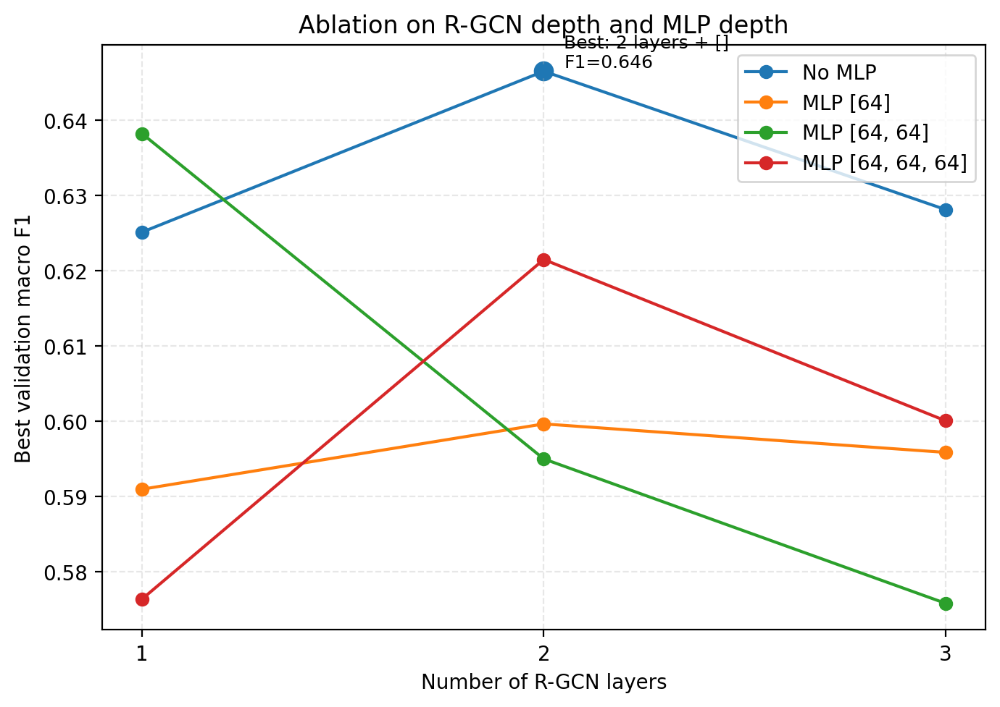
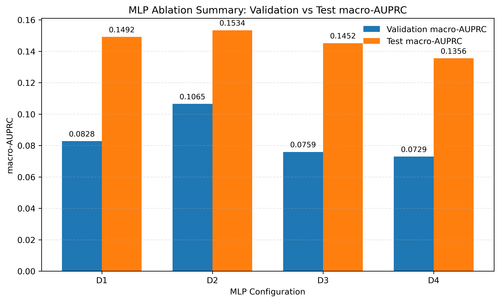

# Financial Risk Research Portfolio

金融风险研究与工程作品集：从财经新闻到知识图谱、风险预测和风险社区演化。

This repository presents two research stages and a financial-risk agent prototype. It includes selected source code, existing tests, prompt templates and recorded experiment figures. Raw news datasets, credentials, model weights and local runtime files are excluded.

| Module | What to inspect | Code |
| --- | --- | --- |
| News graphs and RGCN | News collection, LLM risk labeling, graph extraction, relational graph classification and depth ablation | [Term 1 research](projects/term1/SourceCode_LINYi_IndustrialProject20/README.md) |
| Financial Risk Agent | Typed contracts, tool gateway, audit records, approval workflow and Streamlit interface | [Agent prototype](projects/term1/financial_risk_agent/README.md) |
| Event extraction and risk communities | Multi-model extraction, entity alignment, company-month risk representations, scoring and community evolution | [Term 2 pipeline](projects/term2/README.md) |

## Suggested reading order

1. [Architecture and module map](docs/architecture.md).
2. [Recorded experiments and limitations](docs/results.md).
3. The module most relevant to the interview, then its existing tests.
4. [Reproduction boundaries](docs/reproduction.md).

## Recorded experiments

The following are existing local experiment artifacts, not newly reproduced results.

## Current status

This is a research portfolio, with incomplete reproduction prerequisites. The Agent README describes the prototype's runtime and deployment limitations. Several legacy-asset integration tests depend on a manifest that was already missing from the source folder. The supplied tests have not been run as a complete suite for this showcase package.

The original material contains a proprietary license declaration in the Agent package; this showcase adds no open-source license and includes no third-party raw news. Some materials were developed in a team context. The accompanying project descriptions state the current reproduction limits without claiming independent authorship of every component.
