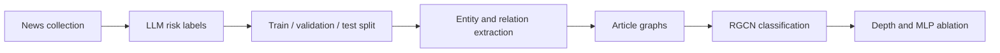
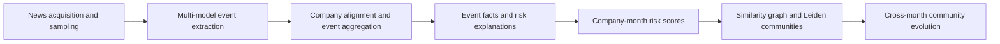

# Architecture and module map

## Term 1: article-level graph research

The research scripts remain in their original filenames to preserve imports. The Agent is a separate application prototype with its own models, adapters, gateway, audit and approval components. Its README and architecture documents distinguish implemented capabilities from planned or deployment-dependent features.

## Term 2: company-month risk research

| Concern | Main files under `projects/term2/方案一/pipeline/` |
| --- | --- |
| Input normalization and extraction | `prepare_inputs.py`, `run_docfee_news.py`, `llm_extract_openai.py`, `multi_model_fusion.py` |
| Company alignment and taxonomy | `global_id_alignment.py`, `event_taxonomy.py` |
| Risk representations and scoring | `aggregate_events.py`, `event_text_repr.py`, `risk_analysis_gen.py`, `risk_analysis_repr.py`, `risk_scorer.py`, `run_risk_scoring.py` |
| Communities and evolution | `community_similarity.py`, `community_graph.py`, `community_detection.py`, `community_evolution.py`, `run_community.py` |
| Evaluation and ablation | `run_mlp_ablation.py`, `run_risk_validation.py`, `run_reliability_backtest.py`, `run_external_evidence_validation.py` |

Directories keep the original relationship between `方案一` and `数据抓取` because an existing test loads the collection module by relative path.
