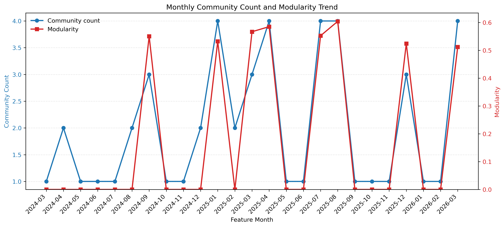
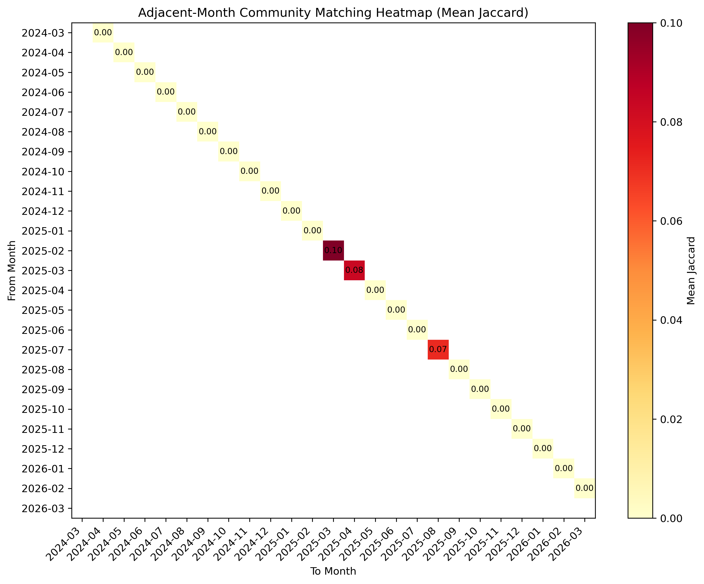

# Recorded results and interpretation

All numbers below are read from existing local artifacts. Packaging did not rerun training or validate the underlying datasets.

## RGCN research

See the retained [ablation CSV](../projects/term1/SourceCode_LINYi_IndustrialProject20/ablation_rgcn_depth_mlp_fast.csv) for all graph and MLP depth settings. The file reports the best validation macro-F1 and corresponding epoch, not independent test performance.

## Company-month MLP

The [original summary table](../results/term2/risk_scoring/mlp_ablation/mlp_ablation_summary_table.csv) reports four configurations with three seeds each. Configuration D2 has recorded validation macro-AUPRC 0.1065 and test macro-AUPRC 0.1534. Its recorded training macro-AUPRC is 0.9746. The train/test gap and low absolute test AUPRC must be considered; the results do not establish production readiness.

## Risk communities

The following figures come from the original `output/community` experiment. They should not be attributed to the separate `community_v2` or `community_v3` settings.

The [aggregate evolution table](../results/term2/community/community_evolution_summary_table.csv) is retained. Per-company risk assignments, raw article evidence and intermediate embedding vectors are excluded.
